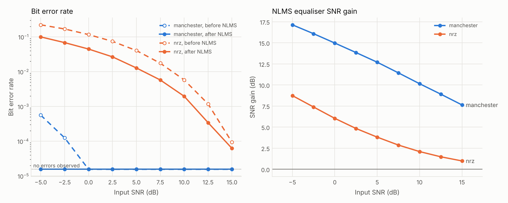
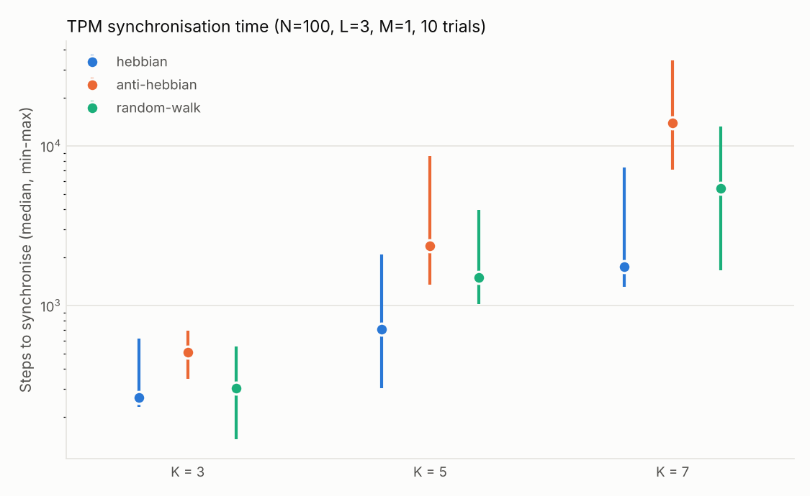

# OpenBDN

[](https://github.com/MACVXACE/openbdn/actions/workflows/ci.yml)
[](LICENSE)
[](pyproject.toml)

**OpenBDN** is a Python SDK that simulates the data path of a Biological Data
Network (BDN-04): information is coded for synthetic-DNA storage, carried
across the body on an electro-quasistatic human body communication (EQ-HBC)
link, and keyed by a neural key-agreement handshake.

It is a *numerical model*, intended for studying coding, equalisation and
synchronisation behaviour. It does not model electrode physics, tissue
impedance, or wet-lab synthesis and sequencing errors.


## Architecture

```
                 ┌──────────────── crypto/vvtpm.py ────────────────┐
                 │  Alice TPM  ⇄  public inputs + output bits  ⇄  Bob TPM │
                 │            → identical weights → 256-bit key           │
                 └─────────────────────────────────────────────────┘

 text ─► bits ─► DNAStorageCodec.encode ─► 2 bits/nt ─► line code ─┐
                  (storage/dna_codec.py)                            │
                                                                    ▼
                                             EQChannelSimulator.add_muscle_noise
                                                  (channel/eq_hbc.py)
                                                                    │
 text ◄─ bits ◄─ DNAStorageCodec.decode ◄─ detector ◄─ NLMS equaliser ◄┘
```

| Layer | Module | Model |
|---|---|---|
| Storage | `openbdn.storage.dna_codec` | Constrained 3-bit → dinucleotide block code |
| Channel | `openbdn.channel.eq_hbc` | Baseband two-level link, non-stationary coloured EMG interference, NLMS equaliser |
| Security | `openbdn.crypto.vvtpm` | Mutual learning of two Tree Parity Machines |
| Integration | `openbdn.pipeline` | `BDNPipeline` chaining storage and channel |
| Evaluation | `openbdn.benchmark` | SNR, line-code and TPM sweeps with CSV and plot export |
| Digital twin | `openbdn.app` | Interactive Streamlit dashboard |

### Storage layer: constrained DNA code

Bits are consumed three at a time and each triple selects one of the eight
dinucleotides that contain exactly one weak base (A/T) and one strong base
(C/G):

| bit | selects | 0 | 1 |
|---|---|---|---|
| b0 | order | weak, strong | strong, weak |
| b1 | weak base | A | T |
| b2 | strong base | C | G |

This gives the constraints by construction, for every input:

- **GC-content = 50 % exactly** (requirement: 40–60 %). Any window of *w*
  bases holds between *w*/2 − 1 and *w*/2 + 1 G/C bases.
- **Longest homopolymer = 2** (requirement: ≤ 3). The two bases of a
  codeword differ, and any three consecutive positions contain a whole
  codeword.
- **Density = 1.5 bit/nt.** For comparison, the capacity of a channel
  constrained only to runs ≤ 3 is about 1.98 bit/nt; the gap is the price of
  a guaranteed, table-driven code with exact local GC balance.

A one-codeword header stores the number of zero bits (0–2) padded onto the
final triple, so strings of any length round-trip exactly. Eight of the
sixteen dinucleotides are not codewords, so many substitution errors are
detected at decode time (`DNADecodeError`).

### Channel layer: EQ-HBC with EMG interference

The transmitter sends a two-level waveform. Manchester coding (default)
places a spectral null at DC and concentrates energy near the bit rate; NRZ is
available for comparison.

`add_muscle_noise` synthesises surface-EMG interference:

1. White Gaussian noise is shaped in the frequency domain by the rational EMG
   spectrum
   `P(f) = f_h⁴ f² / ((f² + f_l²)(f² + f_h²)²)` with `f_l = 60 Hz`,
   `f_h = 120 Hz` (after Shwedyk et al.).
2. The result is amplitude-modulated by a smoothed random telegraph envelope
   (rest ↔ contraction), making it non-stationary.
3. It is scaled so the record has exactly the requested SNR.

`apply_adaptive_filter` runs a centred `num_taps`-tap NLMS equaliser:

```
y[n]   = wᵀ u[n]
e[n]   = d[n] − y[n]
w     ← w + μ e[n] u[n] / (ε + u[n]ᵀ u[n])
```

`d[n]` is a known preamble sample while training data is available and the
sliced decision on `y[n]` afterwards (decision-directed mode). Because the
interference is narrowband relative to the data, the taps converge towards the
Wiener filter that notches the EMG band.

Measured on 4 000-bit records, decision-directed, default parameters, five
seeds:

| Input SNR | Manchester gain | NRZ gain | NRZ BER before → after |
|---|---|---|---|
| 0 dB | ≈ +15 dB | ≈ +6.5 dB | 0.116 → 0.035 |
| 5 dB | ≈ +12.5 dB | ≈ +4 dB | 0.043 → 0.011 |
| 10 dB | ≈ +10 dB | ≈ +2 dB | 0.0041 → 0.0013 |

With Manchester coding the half-bit differential detector already rejects most
of the EMG, so the bit error rate is near zero before and after filtering at
these SNRs; the equaliser's benefit there appears in waveform SNR. NRZ shares
the EMG band and shows the difference in bit errors.

**Modelling caveat.** Practical EQS-HBC carriers sit far above the EMG band,
where EMG is removed by front-end filtering. OpenBDN deliberately uses a
low-rate baseband abstraction (8 kHz sampling, 2 kbit/s) so that in-band
biological interference and its adaptive suppression can be studied.

### Security layer: Tree Parity Machine key agreement

Each party holds a network with `K` hidden units, `N` inputs per unit, and
integer weights `w ∈ [−L, L]`. For a public input `x`:

```
h_k = Σ_j w_kj x_kj      σ_k = +1 if h_k > 0 else −1      τ = Π_k σ_k
```

Both parties publish `τ`. When `τ_A = τ_B`, each updates only the hidden units
with `σ_k = τ`:

```
w_kj ← clip(w_kj + τ x_kj, −L, L)        (Hebbian)
```

Anti-Hebbian and random-walk rules are also implemented. Once the weight
matrices are equal they are hashed with SHAKE-256 into a key.

`VectorValuedTPM` generalises the binary machine to integer input components
`x ∈ {−M, …, −1, 1, …, M}`; `M = 1` is the classical TPM. This is OpenBDN's own
formulation and is not a line-by-line reproduction of the VVTPM of Jeong et
al. (2021).

> **Security notice.** Neural key exchange is a research construction.
> Geometric, genetic and majority attacks against TPM synchronisation are
> published, and the scheme has no reduction to a standard hardness
> assumption. Do not use it to protect real data.

## Installation

Requires Python 3.10 or newer.

```bash
git clone https://github.com/MACVXACE/openbdn.git
cd openbdn
pip install .
```

The Streamlit dashboard is an optional extra:

```bash
pip install ".[app]"
```

For development (adds `pytest` and the dashboard dependencies):

```bash
pip install -e ".[dev]"
pytest
```

## CLI usage

### `openbdn simulate-sync`

```console
$ openbdn simulate-sync --seed 7
╭─────── VV-TPM key agreement ───────╮
│ K=3  N=100  L=3  M=1  rule=hebbian │
│ initial weight overlap: 13.3%      │
╰────────────────────────────────────╯

  Synchronised                yes
  Steps (inputs exchanged)    316
  Weight updates              210
  Final weight overlap        100.0%
  Shared 256-bit key:
  e7f838776597c5a7539ead76dd0b1feef90366c795ae5c359f29c10f8b48c33f
```

A live progress bar tracks weight overlap while the machines learn. Options:
`--k`, `--n`, `--l`, `--m`, `--rule {hebbian,anti_hebbian,random_walk}`,
`--max-steps`, `--seed`. The exit status is 1 if the step budget runs out.

### `openbdn transmit`

```console
$ openbdn transmit "Hello, BDN-04" --snr-db 0 --seed 7
DNA storage layer
┌─────────────────────┬──────────────────────────────────────────────────────┐
│ Strand              │ AGTCTCACCTTCGAGACATGTGACCTGTCAGACAAGACACCAAGAGACCATC │
│                     │ TGCATCCTCACTACAGGAAC                                 │
│ Length              │ 72 nt                                                │
│ GC-content          │ 50.0%                                                │
│ Longest homopolymer │ 2                                                    │
└─────────────────────┴──────────────────────────────────────────────────────┘
EQ-HBC channel
┏━━━━━━━━━━━━━━━━┳━━━━━━━━━━━━━┳━━━━━━━━━━━━┓
┃ Metric         ┃ Before NLMS ┃ After NLMS ┃
┡━━━━━━━━━━━━━━━━╇━━━━━━━━━━━━━╇━━━━━━━━━━━━┩
│ SNR            │     0.34 dB │   13.89 dB │
│ Bit error rate │      0.0000 │     0.0000 │
└────────────────┴─────────────┴────────────┘
SNR gain: +13.55 dB over 144 payload bits
╭──────────────────────────── Recovered message ─────────────────────────────╮
│ Hello, BDN-04                                                              │
╰────────────────────────────────────────────────────────────────────────────╯
```

The SNR figures are measured over the payload, after a 256-bit training
preamble, which is why the input SNR differs slightly from the requested
whole-frame value. Options: `--snr-db`, `--line-code {manchester,nrz}`,
`--taps`, `--step-size`, `--seed`.

The link has no forward error correction: a single residual bit error can
make the strand undecodable, in which case the command reports the failure
and exits with status 1, for example
`openbdn transmit "Hello, BDN-04" --snr-db 3 --line-code nrz --seed 7`.

## Benchmark suite

```bash
openbdn benchmark                      # full sweep, about 30 s
openbdn benchmark --quick              # reduced sweep, a few seconds
openbdn benchmark -o results --trials 20 --sync-trials 25 --seed 1
```

The full run evaluates:

- **Channel:** input SNR from −5 dB to +15 dB in 2.5 dB steps, for both line
  codes, 8 noise realisations of 4 000 bits each. Every operating point
  reuses the same payloads and noise seeds, so the curves differ only by the
  parameter being swept. The equaliser runs decision-directed, with no
  preamble.
- **Key agreement:** K ∈ {3, 5, 7} × {Hebbian, anti-Hebbian, random walk},
  N = 100, L = 3, 10 exchanges each, budget 200 000 steps.

Options: `--output-dir/-o`, `--quick`, `--trials`, `--bits`, `--sync-trials`,
`--n`, `--max-steps`, `--plots/--no-plots`, `--seed`.

### Output files

Written to `benchmark_results/` by default:

| File | Contents |
|---|---|
| `channel_benchmark.csv` | One row per line code and SNR: `line_code, snr_db, trials, bits_per_trial, snr_in_db, snr_out_db, snr_gain_db, ber_unfiltered, ber_filtered, bit_errors_unfiltered, bit_errors_filtered` |
| `tpm_sync_benchmark.csv` | One row per K and rule: `k, n, l, m, rule, trials, max_steps, synchronized, success_rate, steps_mean, steps_median, steps_std, steps_min, steps_max` |
| `channel_benchmark.png` | BER and SNR-gain curves |
| `tpm_sync_benchmark.png` | Synchronisation time by K and rule |

Step statistics cover only the exchanges that synchronised; if none did they
are written as `nan`.

### Plot previews

Both figures below come from `openbdn benchmark` with the default seed.



**`channel_benchmark.png`.** *Left:* bit error rate against input SNR on a
log axis, one colour per line code, dashed before the NLMS filter and solid
after it. Points where no error was observed sit on the dotted floor at half
the measurement resolution (1.6 × 10⁻⁵ for 32 000 bits). NRZ falls from 0.22
to 0.10 at −5 dB and from 5.8 × 10⁻³ to 2.0 × 10⁻³ at 10 dB. Manchester shows
errors only at −5 and −2.5 dB before filtering and none after. *Right:* SNR
gain of the equaliser. It is largest when the interference is strongest
(+17.1 dB Manchester, +8.8 dB NRZ at −5 dB) and shrinks as SNR rises (+7.6 dB
and +1.0 dB at 15 dB).



**`tpm_sync_benchmark.png`.** Median steps to full synchronisation (marker)
with the fastest-to-slowest range (bar), log axis, grouped by K. Median steps
in the reference run:

| K | Hebbian | Anti-Hebbian | Random walk |
|---|---|---|---|
| 3 | 264 | 508 | 303 |
| 5 | 710 | 2 367 | 1 489 |
| 7 | 1 742 | 13 880 | 5 437 |

Synchronisation time grows with K for every rule; the anti-Hebbian rule
grows fastest. With 10 exchanges per cell these medians are indicative, not
precise: the min–max bars span up to a factor of six.

### From Python

```python
from openbdn.benchmark import BenchmarkConfig, benchmark_channel, run_benchmark

report = run_benchmark("results", BenchmarkConfig(channel_trials=20, seed=1))
rows = benchmark_channel(snrs_db=[0, 5], line_codes=["nrz"], num_taps=65)
```

## Digital twin dashboard

```bash
pip install ".[app]"
streamlit run openbdn/app.py      # from the repository root
openbdn-digital-twin              # equivalent, from anywhere
```

The dashboard opens in the browser with three tabs:

- **EQ-HBC channel.** Sliders for channel SNR, resting EMG level, contraction
  rate, EMG spectral corners, filter taps and step size, plus a line-code
  switch. Every change re-simulates the link and updates four metrics (SNR
  before and after NLMS with the gain, BER before and after), a zoomable
  overlay of the transmitted, received and filtered waveforms, and a
  short-time SNR chart that shows the equaliser converging and the dips
  caused by muscle contractions.
- **TPM key exchange.** Choose K, N, L, M, the learning rule and a step
  budget, then press *Run key exchange*. The weight-overlap curve is redrawn
  live while Alice and Bob learn; at the end the tab reports steps, weight
  updates, final overlap and the derived key.
- **End-to-end transmission.** Type a message to see its DNA strand, GC
  content, longest homopolymer, equaliser gain and whether it survived the
  channel.

## Python API

```python
import numpy as np
from openbdn import (
    BDNPipeline, DNAStorageCodec, EQChannelSimulator, VectorValuedTPM, synchronize,
)

# Storage
codec = DNAStorageCodec()
dna = codec.encode("0100100001101001")          # 'TCTCTCACCTCACA'
assert codec.decode(dna) == "0100100001101001"

# Channel
ch = EQChannelSimulator(seed=0)
bits = np.random.default_rng(0).integers(0, 2, 4000)
clean = ch.modulate(bits)
noisy = ch.add_muscle_noise(clean, snr_db=0.0)
filtered = ch.apply_adaptive_filter(noisy)
print(ch.snr_db(clean, noisy), ch.snr_db(clean, filtered))

# Key agreement
alice, bob = VectorValuedTPM(seed=1), VectorValuedTPM(seed=2)
result = synchronize(alice, bob, rng=3)
print(result.steps, result.key)

# End to end
report = BDNPipeline(seed=7).transmit("Hello, BDN-04", snr_db=0.0)
print(report.success, report.snr_gain_db)
```

## Testing

```bash
pytest
```

The suite (201 tests) covers, among other things:

- exhaustive round-trip of all 8 191 binary strings of length 0–12, plus
  2 000 random strings, with GC and homopolymer limits asserted on each;
- TPM synchronisation within 20 000 steps for five architectures and all
  three learning rules;
- exact SNR calibration and spectral colouring of the EMG model, and SNR and
  bit-error improvement from the NLMS filter in both line codes;
- the benchmark: sweep coverage, determinism, CSV schema and round-trip,
  valid PNG output, and edge cases (single points, zero observed errors,
  exhausted step budgets, invalid arguments);
- the dashboard, rendered headlessly with Streamlit's `AppTest`, including
  slider changes and a key exchange started from the button.

## Project layout

```
openbdn/
├── __init__.py
├── app.py
├── benchmark.py
├── cli.py
├── pipeline.py
├── channel/eq_hbc.py
├── crypto/vvtpm.py
└── storage/dna_codec.py
docs/images/          # reference benchmark plots
tests/
├── test_benchmark.py
├── test_channel.py
├── test_cli.py
├── test_crypto.py
└── test_storage.py
```

## References

1. I. Kanter, W. Kinzel, E. Kanter, "Secure exchange of information by
   synchronization of neural networks," *Europhysics Letters* 57, 141 (2002).
2. A. Klimov, A. Mityagin, A. Shamir, "Analysis of neural cryptography,"
   *ASIACRYPT 2002*.
3. A. Ruttor, "Neural Synchronization and Cryptography," arXiv:0711.2411.
4. S. Jeong, C. Park, D. Hong, C. Seo, N. Jho, "Neural Cryptography Based on
   Generalized Tree Parity Machine for Real-Life Systems," *Security and
   Communication Networks* (2021), doi:10.1155/2021/6680782.
5. E. Shwedyk, R. Balasubramanian, R. N. Scott, "A nonstationary model for
   the electromyogram," *IEEE Trans. Biomed. Eng.* BME-24 (1977).
6. S. Maity et al., "Bio-Physical Modeling, Characterization, and
   Optimization of Electro-Quasistatic Human Body Communication,"
   *IEEE Trans. Biomed. Eng.* 66 (2019).
7. S. Haykin, *Adaptive Filter Theory*, Pearson.
8. N. Goldman et al., "Towards practical, high-capacity, low-maintenance
   information storage in synthesized DNA," *Nature* 494 (2013).

## License

MIT. See [LICENSE](LICENSE).
